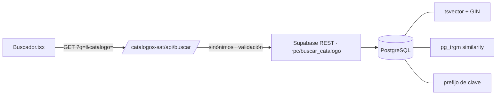

<div align="center">

# 🗂️ Buscador de catálogos del SAT

**Encuentra la clave correcta para tus facturas CFDI 4.0 escribiendo en palabras normales.**

Más de 55,000 claves de productos, servicios, unidades, uso del CFDI, régimen fiscal y formas de pago, con búsqueda de texto completo en PostgreSQL.

[](https://nextjs.org)
[](https://www.typescriptlang.org)
[](https://tailwindcss.com)
[](https://vercel.com)
[](https://supabase.com)

🌐 **[herramientas.totalsecuritysh.com/catalogos-sat](https://herramientas.totalsecuritysh.com/catalogos-sat)**

</div>

## 🤔 ¿Para qué sirve?

Al emitir una factura, el SAT obliga a llenar varios campos con claves de sus catálogos. Nadie se las sabe de memoria:

| Catálogo | Campo del CFDI | Ejemplo |
|---|---|---|
| Productos y servicios | `ClaveProdServ` de cada concepto | laptop → **43211503** |
| Unidades | `ClaveUnidad` de cada concepto | pieza → **H87**, servicio → **E48** |
| Uso del CFDI | Uso que le dará el cliente | **G03** Gastos en general |
| Régimen fiscal | Régimen del emisor y receptor | **626** RESICO |
| Forma de pago | Cómo se pagó | **03** Transferencia |
| Método de pago | Cuándo se paga | **PUE** / **PPD** |
| Objeto de impuesto | Si el concepto causa impuestos | **02** Sí objeto de impuesto |

## ✨ Funcionalidades

| | |
|---|---|
| 🔎 **Búsqueda tolerante** | Sin acentos, con errores de dedo ("conputadora") y sinónimos comunes ("laptop", "celular"). |
| 🔢 **Por clave** | Escribe el inicio de una clave para ver toda la familia (ej. `4321`). |
| 🏷️ **Filtro por catálogo** | Con una explicación de en qué parte de la factura se usa cada uno. |
| 📋 **Copiar** | Clic en la clave para copiarla. |
| ⚡ **Rápido** | Índices GIN de texto completo y trigramas; respuestas cacheadas en el CDN de Vercel. |

## 🏗️ Arquitectura



```
├── scripts/
│   ├── exportar_catalogos.py   genera el CSV desde los catálogos del SAT
│   └── cargar_datos.sh         aplica la migración y carga el CSV en tu base
├── supabase/
│   ├── migrations/…_catalogos_sat.sql   tabla, índices, RLS y función de búsqueda
│   └── seed/catalogos.csv               55,019 registros
└── src/
    ├── app/api/buscar/route.ts   proxy a la función SQL con caché
    ├── components/Buscador.tsx   interfaz
    └── lib/catalogos.ts          nombres, ayudas y sinónimos
```

### La búsqueda en SQL
`buscar_catalogo(consulta, filtro_catalogo, limite)` combina cuatro estrategias y ordena por relevancia:

1. **Prefijo de clave** (`43211503`, `E4`), con comodines escapados.
2. **Texto completo** en español con todas las palabras (`websearch_to_tsquery`).
3. **Cualquier palabra**, para consultas largas.
4. **Similitud por trigramas** (`pg_trgm`) para errores de escritura.

La tabla tiene **RLS** de solo lectura: el rol anónimo puede consultar pero no escribir.

## 🛢️ Configurar la base de datos (Supabase)

1. Crea un proyecto en [supabase.com](https://supabase.com) (el plan gratuito alcanza).
2. Copia la cadena de conexión en **Project Settings → Database → Connection string (URI)**.
3. Carga los datos (requiere `psql`):

```bash
DATABASE_URL="postgresql://postgres:<contraseña>@db.<proyecto>.supabase.co:5432/postgres" ./scripts/cargar_datos.sh
```

El script aplica la migración, carga el CSV y verifica con una búsqueda de prueba.

## 🔑 Variables de entorno

| Variable | Dónde se obtiene |
|---|---|
| `SUPABASE_URL` | Project Settings → API → Project URL |
| `SUPABASE_ANON_KEY` | Project Settings → API → `anon` public key |

`DATABASE_URL` solo se usa para cargar datos desde tu equipo; **no** se configura en Vercel.

## 🚀 Correr en local

```bash
git clone https://github.com/TotalSecurity-SH/catalogos-sat.git
cd catalogos-sat
npm install
cp .env.example .env.local   # llena SUPABASE_URL y SUPABASE_ANON_KEY
npm run dev
```

Abre http://localhost:3000/catalogos-sat

### Actualizar los catálogos
Cuando el SAT publique una nueva versión, actualiza el paquete (`pip install -U satcfdi`), regenera el CSV con `python3 scripts/exportar_catalogos.py` y vuelve a ejecutar `cargar_datos.sh`.

### Multi-zones
Esta herramienta es una **zona** del hub [`tsh-herramientas`](https://github.com/TotalSecurity-SH/tsh-herramientas). Se publica con `basePath: "/catalogos-sat"` en su propio proyecto de Vercel y el hub la sirve en `herramientas.totalsecuritysh.com/catalogos-sat` mediante *rewrites*. Cada herramienta vive en su propio repo, pero el usuario ve una sola plataforma.

## ☁️ Desplegar en Vercel

1. Importa el repositorio en [vercel.com/new](https://vercel.com/new). Framework: **Next.js**.
2. Agrega `SUPABASE_URL` y `SUPABASE_ANON_KEY` en **Environment Variables**.
3. **Deploy**. Queda en `https://<proyecto>.vercel.app/catalogos-sat`.
4. En el proyecto del hub, define `CATALOGOS_SAT_URL` con esa URL y vuelve a desplegar el hub.

## 📄 Datos

Catálogos del Anexo 20 del SAT (CFDI 4.0), extraídos del paquete abierto [satcfdi](https://pypi.org/project/satcfdi/) (licencia MIT). Herramienta independiente, sin relación con el SAT.

<div align="center">

Hecho por **[Carlos Santiago](https://carlossantiago.totalsecuritysh.com)** · [Total Security SH](https://totalsecuritysh.com) · Full Stack Developer · IA y Automatización

</div>
